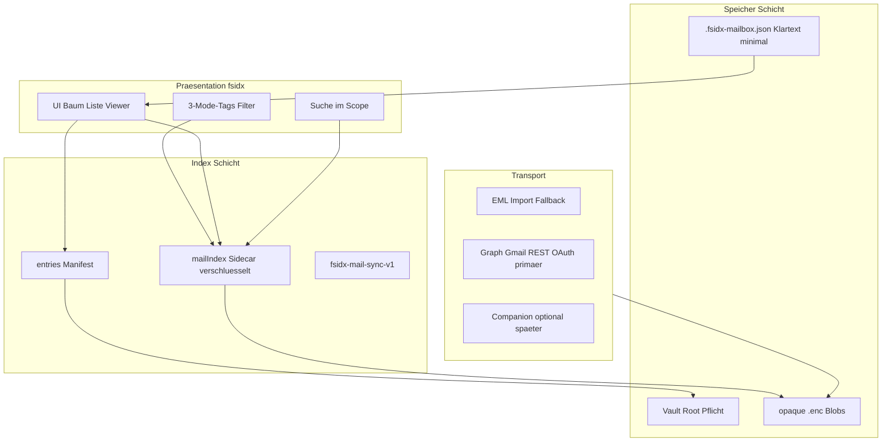
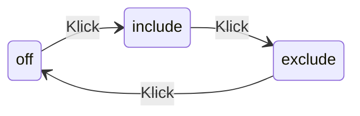
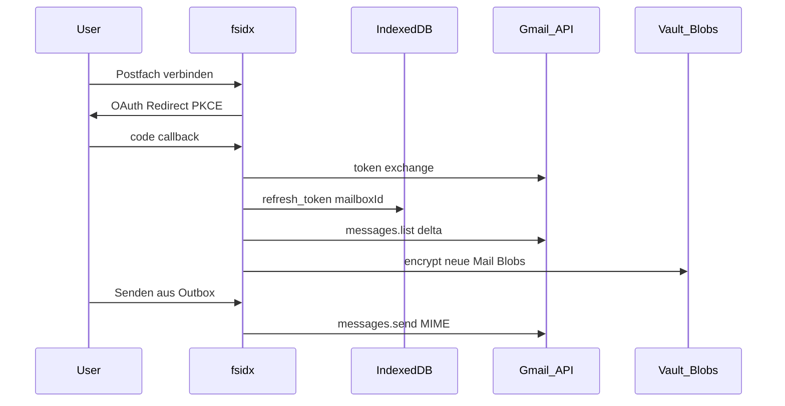

# Verbessertes Konzept: Vertrauliches Postfach im Workspace

## Leitidee (präzisiert)

Ein **Mail-Postfach** ist kein „verschlüsseltes Thunderbird im Dateisystem“, sondern ein **fsidx-Ordnertyp** mit:

1. **Vertraulichkeit auf der Platte** — Mail-Inhalt liegt wie im Tresor nur als opake, verschlüsselte Blobs (AES-GCM-256, bestehendes [Vault-Modell](public/schemas/fsidx-vault.v1.schema.json)). Wer den Workspace-Ordner in Explorer, Backup oder Cloud-Sync sieht, **liest keine Betreffzeilen, Adressen oder Anhänge** ohne Passwort/Schlüsseldatei.
2. **Semantik nur in fsidx** — Ordner „Inbox / Sent / …“ sind **logisch** (Manifest + Marker), nicht 1:1 als lesbare Unterordner auf Disk.
3. **Transport getrennt** — Nach der Basis: **OAuth + REST** (Gmail API, Microsoft Graph) aus dem Tab; Import bleibt Fallback; kein Raw-IMAP/SMTP; Companion nur für künftige Nicht-OAuth-Provider.

Verschlüsselung ist damit primär **Sicherheitsziel Vertrauligkeit** (Verfügbarkeit/Integrität nur ergänzend: Viewer-Sandbox, explizite Exports).

---

## Drei Schichten (technisch korrekt)



| Schicht | Verantwortung | fsidx-Baustein heute |
|---------|---------------|----------------------|
| **Speicher** | At-rest-Verschlüsselung, opake Namen | [`vault-io.ts`](src/lib/vault/vault-io.ts), [`vault-session.ts`](src/lib/vault/vault-session.ts) |
| **Index** | Logische Ordner, Suchfelder, Sync-UIDs | Manifest [`useFileIndex.ts`](src/hooks/useFileIndex.ts), Sidecar-Muster wie Links/ET2 |
| **Transport** | Provider-Anbindung | Neu; **nicht** im Vault-Root speichern |

**Invariante:** Unter einem Postfach gibt es **keine Klartext-`.eml`** auf Disk. Entschlüsselung erfolgt **streamend im RAM** beim Lesen, Schreiben **re-encrypt** vor `createWritable()`.

---

## Ordnertyp „Postfach“

### Marker `.fsidx-mailbox.json` (`fsidx-mailbox-v1`)

Nur **nicht-geheime** Konfiguration im Klartext (wie `.fsidx-vault.json`):

- `schema`, `mailboxId` (UUID)
- **Pflicht:** `vaultRoot` — relativer Pfad; Postfach-Root **muss** ein entsperrbarer Vault sein (gleicher Key wie Parent-Tresor oder eigener Sub-Vault)
- `logicalFolders`: feste Systemordner `inbox`, `outbox`, `sent`, `drafts`, `trash` + optional gemappte IMAP-Pfade
- `transport`: `{ mode: "import" | "oauth", provider: "google" | "microsoft", accountHint? }` ohne Tokens

**Geheimnisse:** Nie im Workspace.

- **OAuth (Priorität):** Access/Refresh-Token in **IndexedDB** pro `mailboxId`, optional mit WebCrypto an Vault-Session gebunden; Refresh rein per `fetch` an Provider-Token-Endpoint (PKCE)
- **Companion (später):** nur wenn Provider keine browser-taugliche API hat

### Logische Ordner vs. physische Platte

- Im **Baum** siehst du `Postfach/Inbox/…` wie normale Ordner.
- Auf Disk: **ein** Vault-Unterbaum mit flachen/sharded Blobs (`sha256-prefix/…`) + verschlüsseltes `mail-index`-Bundle pro Ordner oder global.
- **IMAP-Realität:** Gmail-Labels → im Index **Referenzen** (`mailId` in mehreren logical folders), nicht Datei-Duplikate.

---

## Dateiformat `fsidx-email-v1`

Eine Nachricht = **ein** verschlüsseltes Blob + **ein** Index-Eintrag:

```json
{
  "schema": "fsidx-email-v1",
  "mailId": "uuid",
  "headers": { "from", "to", "cc", "subject", "date", "messageId" },
  "state": "draft | outbox | sent | received | archived",
  "body": { "text": "...", "htmlRef": "blob://..." },
  "attachments": [{ "name", "mime", "size", "blobRef" }],
  "tags": ["projekt-x", "wichtig"],
  "sync": { "imapUid?", "folder?", "remoteMessageId?", "detached": false }
}
```

- **`tags`:** frei vom Nutzer vergebene **fsidx-Tags** (Strings, normalisiert: trim, Kleinbuchstaben oder Nutzer-Präferenz). Getrennt von Provider-Labels (Gmail/Outlook) — die liegen optional unter `sync.providerLabels` und werden **nicht** automatisch mit `tags` vermischt, können aber per Aktion „Als Tag übernehmen“ kopiert werden.
- Gespeichert als JSON **nur verschlüsselt** im Vault (nicht als lesbare `.fsidx-email.json` im Explorer).
- Für **Move außerhalb** des Postfachs: explizites Zielformat (siehe unten).

**Viewer** ([`file-viewers.ts`](src/lib/file-viewers.ts) → neuer Kind `email`):

- Plaintext-Body direkt; HTML in **sandboxed iframe** oder sanitized (DOMPurify), **keine** Remote-Ressourcen standardmäßig
- Anhänge: nur **„Speichern unter…“** via Download-API nach Nutzerklick (Vertrauligkeit beim Export warnen)

---

## 3-Mode-Tags (Klassifikation und Filter)

Jede Mail kann **beliebig viele Tags** tragen. In der Listen-/Postfach-Ansicht filtert man über eine **Tag-Leiste**: pro bekannter Tag ein Drei-Modus-Schalter **`off` | `include` | `exclude`**.

### Modi pro Tag (Filterkontext)

| Modus | Wirkung auf die angezeigte Liste |
|-------|----------------------------------|
| **off** | Tag wird für den Filter **ignoriert** (neutral). |
| **include** | Mail muss diesen Tag **besitzen**. Mehrere `include`-Tags: **UND** — alle gesetzten Includes müssen auf der Mail vorkommen. |
| **exclude** | Mail darf diesen Tag **nicht** besitzen. Mehrere `exclude`-Tags: jede Exclude-Bedingung gilt (Mail mit **irgendeinem** Exclude-Tag fällt raus). |

**Sichtbarkeit einer Mail:**

1. Für **jeden** Tag mit Modus `include`: Tag ∈ `mail.tags`
2. Für **jeden** Tag mit Modus `exclude`: Tag ∉ `mail.tags`
3. Tags mit Modus `off` spielen keine Rolle

Kein `include` gesetzt → nur Exclude (plus Ordner/Scope/Suche) schränkt ein. Pro Tag immer **genau ein** Modus (kein Include+Exclude gleichzeitig).



### Tag-Vokabular und Persistenz

| Daten | Wo | Vertraulichkeit |
|-------|-----|-----------------|
| `mail.tags` | in `fsidx-email-v1` (verschlüsselt) | at rest im Tresor |
| Vorschlagsliste bekannter Tags | verschlüsseltes Sidecar `mail-tag-index-v1` pro Postfach oder Einträge im `mailIndex` | nur bei Unlock |
| Filterzustand (Modus pro Tag) | IndexedDB / Session pro `mailboxId`; optional gespeicherte Presets | nicht im Workspace |

Tag vergeben/entfernen: Mail-Detail, Mehrfachauswahl in der Liste. **Phase-2-Sync:** OAuth-Pull überschreibt **nicht** `tags`.

### UI

- Postfach-Toolbar: Tag-Chips mit Zustandsfarbe (neutral / Include / Exclude), Klick zyklisch `off → include → exclude → off`.
- Liste: Filter **clientseitig** auf Index-Zeilen (Header + `tags`, ohne Body).
- Kombination mit Textsuche: Scope/Ordner → 3-Mode-Tags → Suchstring (wie ET2-Filter in der Kopfzeile, aber dreistufig pro Tag).

---

## Workflow Outbox → Gesendet

Zustandsmaschine (lokal konsistent, unabhängig von Transport):

| Zustand | Bedeutung | UI |
|---------|-----------|-----|
| `draft` | Bearbeitung | Ordner Drafts |
| `outbox` | Sendeauftrag freigegeben | Outbox |
| `sending` | Transport läuft (OAuth API) | Spinner, Retry |
| `sent` | Erfolg lokal bestätigt | Sent |
| `failed` | SMTP/API-Fehler | Outbox mit Fehlertext |

**Phase 1 (ohne Konto):** „Senden“ = `outbox` → `sent` (lokal), Import EML; optional „Als EML exportieren“.

**Phase 2 (OAuth):** Senden = MIME aus Vault bauen → Gmail `users.messages.send` / Graph `sendMail`; bei Erfolg `sent` + `remoteMessageId`; bei Fehler `failed` mit API-Detail.

**Konkurrenz:** `mailId` stabil; Outbox-Sperre in **IndexedDB** pro Postfach (analog E2 Multi-Tab).

---

## Vertraulichkeit — was Verschlüsselung leistet (und was nicht)

### Leistet (Hauptziel)

- **At rest:** Workspace auf USB, NAS, geteiltes Projektverzeichnis, Cloud-Sync — Mail bleibt **ciphertext**.
- **Metadaten-Minimierung auf Disk:** auch Dateinamen opak (Vault Base64URL-Namen); im Explorer kein `Rechnung_KundeXY.eml`.
- **Tresor sperren:** Nach Lock nur noch Platzhalter-Zähler ([`opaqueOnDiskCounts`](src/lib/vault/vault-session.ts)) — fsidx zeigt Postfach-Struktur nur mit Unlock.

### Leistet nicht allein

- Schutz **während** Anzeige (Phishing, HTML-Betrug) → Viewer-Policy + Nutzerhinweise
- Schutz nach **bewusstem Export** (Klartext-EML ins Projekt) → Nutzerentscheidung + UI-Warnung
- Server-seitige E2E-Mail (PGP/S/MIME) → separates optionales Modul, nicht Vault-Ersatz

### Suche im Postfach

Technisch sauber bei Vertraulichkeit:

- **Empfohlen (MVP):** Volltextsuche nur bei **entsperrtem** Vault — Scan der entschlüsselten Header/Body **im RAM**, kein Klartext-Index auf Disk
- **Optional später:** blind index / header-only-token in separatem verschlüsselten Sidecar (Komplexität ↑)

---

## Verschieben in andere Workspace-Ordner

Drei **explizite** Stufen (Kontextmenü, nicht stiller Default):

| Stufe | Ziel | Vertraulichkeit | Typ |
|-------|------|-----------------|-----|
| **A** | Anderer Ordner **im gleichen Vault** | weiter verschlüsselt | `fsidx-email-v1`, Viewer `email`, `sync.detached=true` |
| **B** | Normaler Ordner, **verschlüsseltes** Artefakt | `.fsidx-email.enc` oder Vault-Blob + Klartext-Stub `.meta.json` nur mit `mailId` | Viewer nach Unlock |
| **C** | Projektordner **Klartext** | `*.eml` oder `*.fsidx-email.v1.json` lesbar | Viewer `email`, **Warndialog** |

`sync.detached=true`: keine weiteren IMAP-Updates für diese Nachricht (verhindert Duplikate).

Analog zu bestehendem Move: [`move-workspace.ts`](src/lib/move-workspace.ts) + Vault-Reencrypt.

---

## Transport — Profile (Priorität: OAuth)

| Profil | Rolle | Technik |
|--------|-------|---------|
| **import** | Phase 1, Offline, Nicht-Google/Microsoft | EML-Import, lokale Outbox/Sent |
| **oauth-api** | **Phase 2, priorisiert** | Gmail API + Microsoft Graph, OAuth2 **PKCE**, `fetch` |
| **companion** | Optional später | Generisches IMAP für andere Provider |

**Nicht** vorgesehen: Raw-Port-993/587 im Tab.

### OAuth-Phase (Detail — umsetzungsrelevant)



| Thema | Gmail | Microsoft Graph |
|-------|-------|-------------------|
| **Scopes (minimal)** | `gmail.readonly`, `gmail.send`, `gmail.modify` (gelesen/Archiv) | `Mail.Read`, `Mail.Send`, `offline_access` |
| **Ordner-Mapping** | Label-IDs → `inbox`, `sent`, …; Systemlabels `INBOX`, `SENT` | `mailFolders` → logische Ordner |
| **Sync** | `historyId` + `users.history.list`; Startpunkt in `fsidx-mail-sync-v1` | `delta` auf Messages oder periodisches `since` |
| **Nachricht holen** | `users.messages.get(format=raw)` → in Vault als `fsidx-email-v1` | `GET /messages/{id}`; Body/Anhänge separat laden |
| **Senden** | RFC822 base64url → `messages.send` | `sendMail` oder MIME-Upload |

**OAuth-App / Hosting:**

- Statisches fsidx (z. B. GitHub Pages): **öffentlicher OAuth-Client** + PKCE; Redirect-URI = fsidx-Deployment-URL (evtl. `?oauth=...` Route im SPA)
- Nutzer mit **eigener** Google Cloud / Azure App Registration möglich (`clientId` in lokaler Einstellung, nicht im Repo)
- Team-Default: eine fsidx-Registrierung mit dokumentierten Redirect-URIs

**Vertraulichkeit vs. Cloud:**

- Provider sieht Mail **sowieso** (Postfach in der Cloud) — Vault schützt **Kopie im Workspace** (Backup, NAS, geteilte Ordner), nicht Transport TLS zum Provider
- Nach Pull: Klartext nur im RAM → sofort verschlüsselt in Vault; API-Responses nicht auf Disk cachen außer verschlüsselt

**Sync im Tab:**

- Kein Dauer-Hintergrund ohne Tab: **manueller Sync**, Intervall-Sync nur bei offenem fsidx; optional später `SharedWorker`/periodischer Pull mit Nutzerzustimmung
- Konflikte: Server-`messageId`/`id` ist Master; lokale Drafts nur in `draft`/`outbox` bis `send`

---

## Phasenplan (festgelegt)

### Phase 1 — Vertrauliches Postfach (Basis, zuerst bauen)

- Tresor + `.fsidx-mailbox.json`
- Logische Ordner, Composer, Import EML, Outbox/Sent lokal
- EmailViewer (sandbox) + Vertrauligkeits-UI
- Tags pro Mail + 3-Mode-Tag-Filter (`include` / `exclude` / `off`)
- Suche bei unlocked Vault, kombinierbar mit Tag-Filtern

### Phase 2 — OAuth Live (priorisiert nach deiner Wahl)

- Google + Microsoft verbinden (PKCE, IndexedDB-Tokens)
- Inbox-Pull → Vault-Blobs; Outbox → API-Send
- `fsidx-mail-sync-v1` pro Postfach
- UI: Sync-Status, Token abmelden, Scope-Hinweise

### Phase 3 — Move-Stufen B/C + Rest

- Export-/Move-Dialog mit Vertrauligkeits-Stufen
- Companion / weitere Provider nur bei Bedarf

---

## Bewertung des verbesserten Konzepts

| Kriterium | Note | Kommentar |
|-----------|------|-----------|
| Passung fsidx | 5/5 | Vault + Manifest + Viewer + Sidecar |
| Technische Korrektheit | 4/5 | Schichten trennen; Browser-Limits respektiert |
| Vertrauligkeit (Verschlüsselung) | 5/5 | Klares at-rest-Modell, keine falsche Malware-Story |
| Komplexität | mittel–hoch | Phase 1 begrenzt; OAuth Phase 2 größer als Companion pro Provider, aber ohne Agent |
| UX vs. Klassiker | 4/5 | Kein 1:1-FS-IMAP-Baum auf Disk — dafür konsistent mit fsidx |

---

## Produktentscheidung (getroffen)

**Priorität: Phase 1 Basis, dann OAuth (Gmail + Microsoft Graph), ohne Companion in Phase 2.**

- Import bleibt immer nutzbar (Offline, Archiv, Provider ohne Anbindung).
- Companion nur Ergänzung für z. B. generisches IMAP, nicht Teil des ersten Live-Sync-Milestones.

---

## Kurz: Original-Idee → verbesserte Aussage

| Ursprünglich | Verbessert |
|--------------|------------|
| Postfach-Ordner = echte FS-Unterordner | Logische Ordner im Index, physisch Vault-Blobs |
| Verschlüsselung = kein Schadcode auf Platte | Verschlüsselung = **Vertrauligkeit** at rest; Viewer/Export für Inhaltsrisiken |
| Nur fsidx sichtbar | Opake Disk + entschlüsselt nur bei Unlock in fsidx |
| Outbox → Sent | Explizite Zustandsmaschine + optional Transport |
| Move = normale Datei + Viewer | Drei Stufen mit `detached` und Export-Warnung |